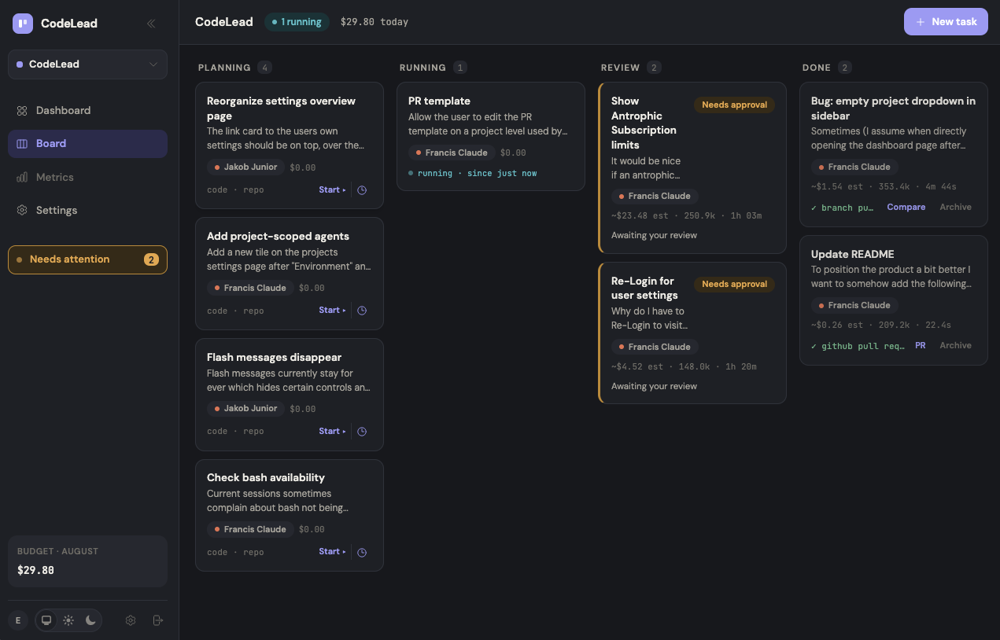
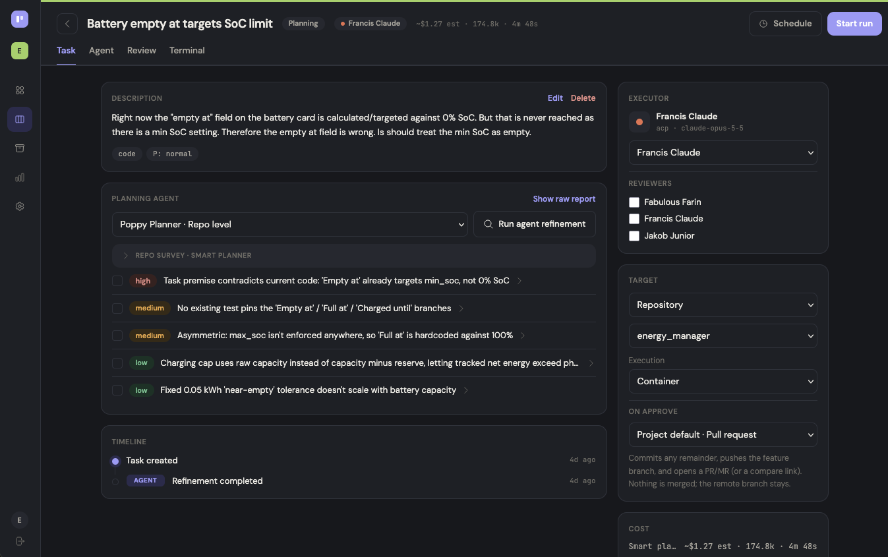
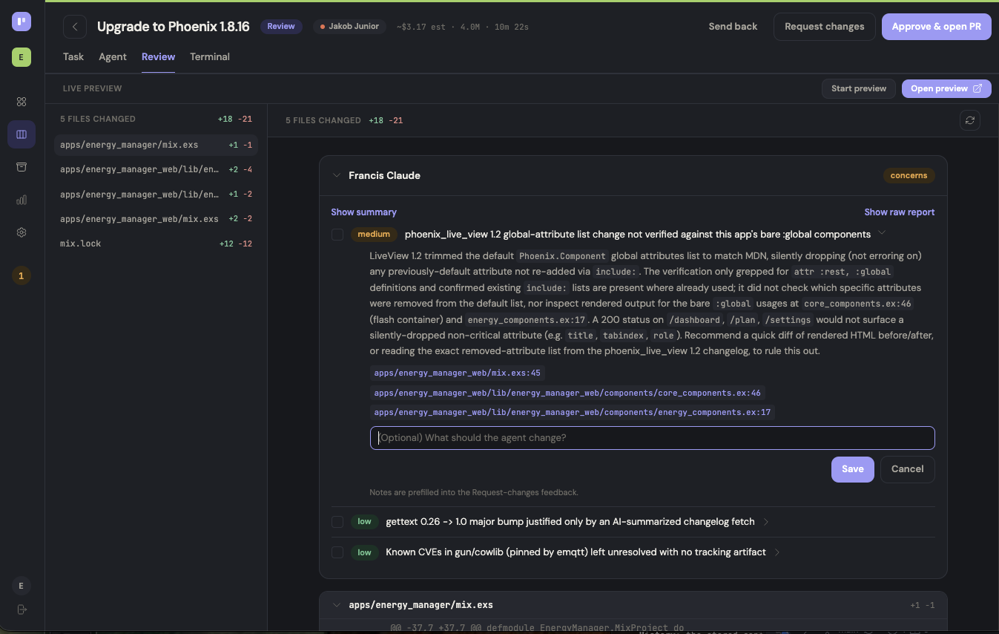

# CodeLead

**Self-hosted orchestration for AI coding agents — built for engineers who stay accountable for what ships.**


<sub>Simplified animation of the real workflow · [Watch in full quality](https://github.com/user-attachments/assets/be9687dd-f0a8-4111-92ed-5990548c8aa2)</sub>

Most agent tools trade control for speed: the agent runs, you skim, you merge. That's fine for experiments. It doesn't hold up when your name is on the release.

CodeLead takes the other side of that trade. Agents (Claude Code, Codex) do the work; **every handoff is a human decision** — spec approved before work starts, isolated branch per task, independent AI review before you look, your explicit approval before anything lands. Nothing happens that you can't see, trace, or stop.

This is not a vibe-coding tool. It's the software engineering practices you already trust — specs, branches, code review, budgets, an audit trail — applied at the boundary between you and your agents.

---

## What it looks like

A four-column board: **Planning → Running → Review → Done**. You write and approve the spec, you start the run, reviewer agents critique the result, you approve it — or send it back with feedback to the same branch and session, or back to Planning for a fresh start.

No "Ready" column, no auto-start, no auto-merge. In agent-driven work you are the bottleneck, so the board models your decisions, not worker capacity.



| Planning: findings before any code | Review: reviewers and diff, then your call |
|---|---|
|  |  |

## Why an engineer would choose this

- **Spec before code.** The planning assistant is a critic, not a code generator. Its findings persist, your resolutions persist, and decisions show on the task card.
- **Isolation by default.** One worktree and branch per task. Optionally a container per task, built from the repository's own devcontainer config, so the agent gets the project's toolchain and can't touch your host.
- **Independent review.** Reviewers are separate agents with separate prompts; they never move a card. Use a cheap local model for a first pass and a frontier model for the security lens.
- **Cost is a first-class number.** Every run's tokens and cost are persisted per task and rolled up per project. Budgets are enforced: a task that would blow the limit is held, not started.
- **Nothing is silent.** Failed runs stay visible with an attention badge. Cancel keeps the worktree for inspection. Every run is an audit step.
- **Agent-agnostic.** Claude Code and OpenAI Codex over the [Agent Client Protocol](https://agentclientprotocol.com); any OpenAI-compatible or Ollama endpoint for review and lightweight work. Not Claude-shaped, not vendor-shaped.
- **Yours.** Self-hosted, single binary-ish Docker image, Postgres, no telemetry, no phone-home. Credentials encrypted at rest.

## Quickstart

CodeLead runs as a small Docker Compose stack. The files are in [`deployment/`](deployment/). You need a Linux (or Mac) host with Docker and the Compose plugin.

```bash
git clone https://github.com/emischorr/codelead.git
cd codelead/deployment
cp .env.example .env        # fill in POSTGRES_PW, APP_DB_PW, SECRET_KEY_BASE, ENCRYPTION_KEY; check DATA_ROOT
docker compose up -d
```

`.env.example` shows how to generate both keys. **Back up `ENCRYPTION_KEY`**: provider credentials and project secrets are encrypted with it, and they can't be recovered without it.

This starts Postgres, runs a one-shot migration, then starts the app on port 4000. Worktrees, task folders and agent state live in `DATA_ROOT` on the host.

Open `http://<host>:4000/setup`. The first-run wizard creates the admin user, connects a provider, links a repo and creates your first agent. Five minutes, no config files.

Before other people use it, set `PHX_HOST` in `docker-compose.yml` to the address they will type. The app serves plain HTTP, so put a TLS-terminating reverse proxy in front of it. Also add `restart: unless-stopped`. To upgrade, run `docker compose pull && docker compose up -d`. Migrations apply automatically. [`docs/deployment.md`](docs/deployment.md) covers URLs, proxy configs, container execution (the docker socket), backups and what to know before exposing an instance.

Prebuilt images: `ghcr.io/emischorr/codelead` (`linux/amd64`, `linux/arm64`).

<sub>Working on CodeLead itself? The root `docker-compose.yml` only starts the dev database. To run a dev server: `docker compose up -d && mix setup && mix phx.server`.</sub>

## How it compares

| | CodeLead | [Kandev](https://github.com/kdlbs/kandev) | [Paperclip](https://github.com/paperclipai/paperclip) | [Symphony](https://github.com/openai/symphony) |
|---|---|---|---|---|
| Human gate at every transition | ✅ mandatory | configurable review gates | configurable approval stages | — (optional handoff state) |
| Structured planning findings | ✅ | — | plan approvals | — |
| Parallel independent reviewer agents | ✅ | — | — | — |
| Per-task cost + enforced budgets | ✅ | experimental (Office mode) | ✅ | token totals only |
| Worktree isolation | ✅ | ✅ | optional | per-issue directories |
| Container isolation | ✅ per task (repo's devcontainer) | ✅ Docker executor | via sandbox providers | left to the implementer |
| Self-hosted, no telemetry | ✅ | ✅ | self-hosted; telemetry on by default | ✅ |
| Primary audience | engineer as product owner | developer | running a "company" of agents | autonomous coding from Linear issues |

<sub>As of November 2026, from each project's own README or spec.</sub>

Kandev is the closest in shape and a good tool: worktrees, ACP agents, a web board, no telemetry. The difference is emphasis. Kandev is a flexible workbench where review gates are something you configure. In CodeLead the gates *are* the model, and planning findings, parallel reviewers and enforced budgets come built in.

## Stack

Elixir · Phoenix LiveView · PostgreSQL · Oban · Docker. Chosen for the same reason as the workflow: long-running, supervised, fault-tolerant processes are what the BEAM is for.

## Status

Used daily by its author for several months; the biggest rough edges are fixed, features still land regularly. Expect a solid core and a few unfinished corners. Issues and design discussions are welcome — especially "I'd need X before I could use this at work."

## Roadmap (short)

Flexible workflows, scheduled dispatch into subscription windows, ops tasks via MCP servers, project memory across tasks. Full list in [ROADMAP.md](ROADMAP.md).

## Licence

[Elastic License 2.0](LICENSE). Free to use, modify and self-host, including inside your company. The only restriction is offering CodeLead itself as a hosted service to others.

One feature, container execution (running tasks inside the repository's own devcontainer), is unlocked with an offline licence key. No phone-home, no account. Everything else runs unrestricted without a key. Commercial licensing and support for teams: [enrico@mischorr.com](mailto:enrico@mischorr.com).

Copyright (c) 2026 Enrico Mischorr